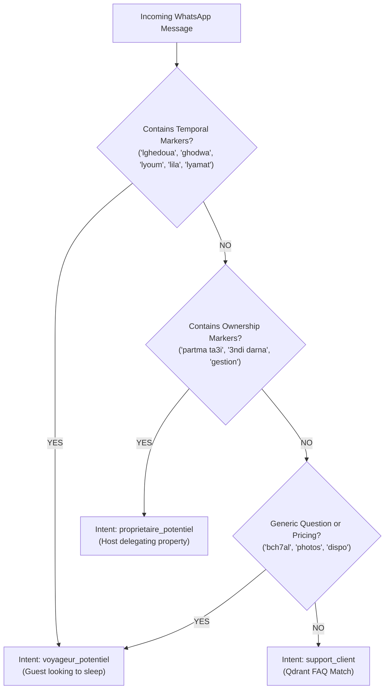

# 🧠 WSP Concierge AI — Intent Disambiguation Engine & NLP Rules

The core intelligence of the WhatsApp Concierge platform lies in its specialized AI router (`AiRouteur1`), tuned to process colloquial North African / Algerian Arabic (**الدارجة الجزائرية**), French, and Modern Standard Arabic with zero misunderstanding.

---

## 🎯 The Core Disambiguation Challenge: "Nekri Partma"

In North African dialects, the root verb **"k-r-y" (كرى / نكري)** can be ambiguous depending on the subject's role:
- *"Nekri partma"* can mean *"I want to rent an apartment to live in"* (Guest).
- *"Nekri partma"* can also mean *"I want to put my apartment up for rental management"* (Owner / Landlord).

### Algorithmic Resolution Rules:

---

## 🔑 Dialect Keyword Matrix

### 1. Guest Signals (`voyageur_potentiel`)
*When a customer wants to stay or sleep in an apartment:*
- **Keywords**: `lghedoua`, `ghedoua`, `ghodwa` (tomorrow), `lyoum` (today), `lila` (tonight), `lyamat` (these days), `bch ner9od` (to sleep), `vacances` (vacation).
- **Phrasing Patterns**:
  - *"Salam Kho rani 7ab nekri partma lghedoua nchallah"*
  - *"Salam kyn dispo lyoum f hydra?"*
  - *"bch7al la nuitée svp?"*
  - *"eb3atli les photos ta3 l'appart f alger"*

### 2. Owner Signals (`proprietaire_potentiel`)
*When a landlord wants the concierge agency to manage their real estate:*
- **Keywords**: `ta3i` (mine), `darti` (my house), `3ndi partma` (I have an apartment), `f2 ta3i`, `confier`, `gestion locative`, `sous-location`, `pourcentage`.
- **Phrasing Patterns**:
  - *"3ndi studio f sidi yahia hab nmdholkm gestion"*
  - *"kifach tkhdmo m3a les propriétaires?"*
  - *"rani msafer w hab nkeri partmati f el biar"*

### 3. Customer Support & Post-Booking (`support_client`)
*When an existing guest asks logistical questions:*
- **Keywords**: `wifi`, `code`, `clé`, `parking`, `climatiseur`, `chauffe-eau`, `retard`.
- Dispatches to **Qdrant Vector Database** storing building rules, access codes, and house guidelines.
